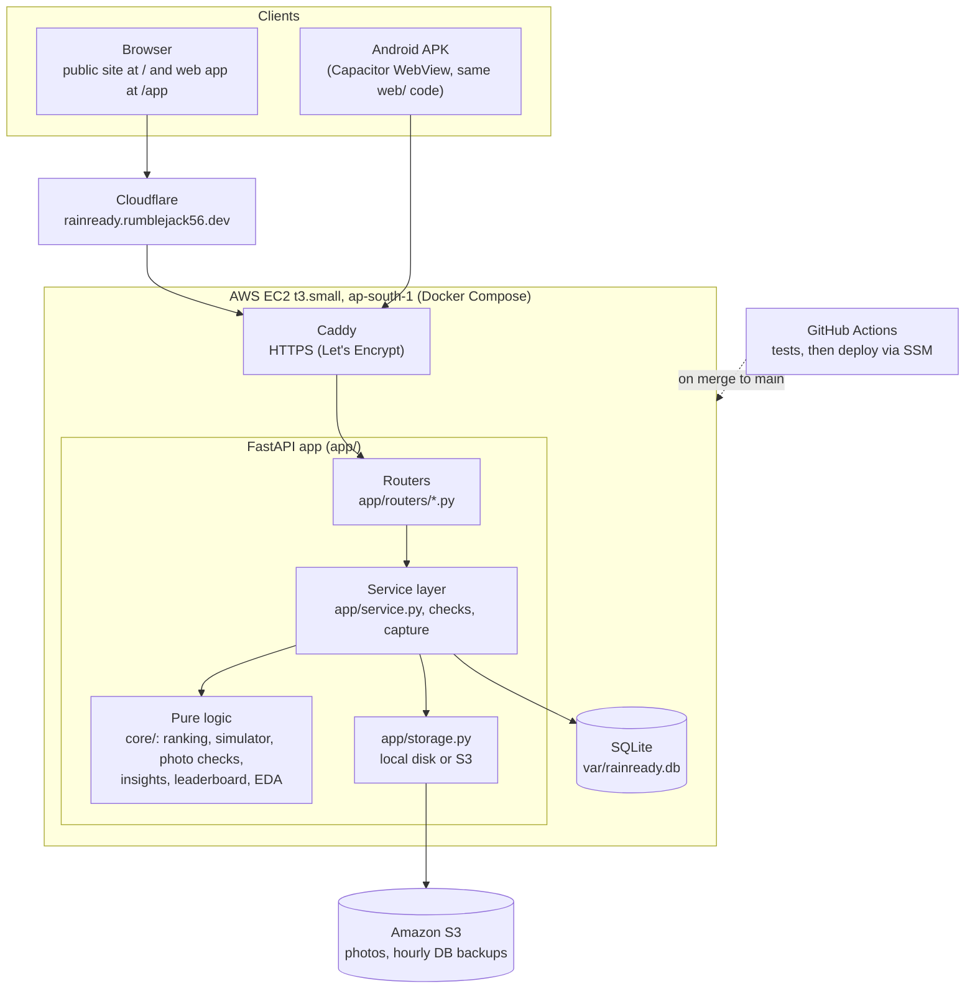
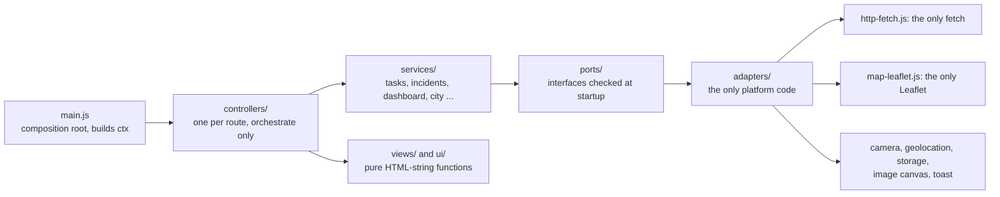

# Rain-Ready

A shared action list for monsoon waterlogging: **what to clean, who owns it, who did it, who checked, did it help.**

Built for the WeMakeDevs x AWS **Environmental Hacks** (October 2026), track Heat and Water. Pilot ward: Old Rajinder Nagar and Karol Bagh, Delhi.

| | |
|---|---|
| Public site | https://rainready.rumblejack56.dev |
| Web app | https://rainready.rumblejack56.dev/app |
| Public board (agency scores and action log) | https://rainready.rumblejack56.dev/board |
| API reference (generated) | https://rainready.rumblejack56.dev/docs |
| Health | https://rainready.rumblejack56.dev/api/health |
| Android app (APK) | [Download rain-ready.apk](https://github.com/RumbleJack56/bharatbuilds/releases/latest/download/rain-ready.apk) |

The same web code also runs as an Android app: [download the APK](https://github.com/RumbleJack56/bharatbuilds/releases/latest/download/rain-ready.apk), or see [Android app](#android-app).

---

## Contents

1. [The problem](#the-problem)
2. [What Rain-Ready does](#what-rain-ready-does)
3. [Features](#features)
4. [Architecture](#architecture)
5. [How ranking and the simulator work](#how-ranking-and-the-simulator-work)
6. [Data](#data)
7. [Where AWS fits](#where-aws-fits)
8. [Repository layout](#repository-layout)
9. [Setup and running locally](#setup-and-running-locally)
10. [Testing](#testing)
11. [Deploying to AWS](#deploying-to-aws)
12. [Android app](#android-app)
13. [API overview](#api-overview)
14. [Further docs](#further-docs)
15. [Limits](#limits)
16. [Team](#team)
17. [Credits](#credits)
18. [License](#license)

---

## The problem

Every monsoon the same Delhi streets flood. Delhi Traffic Police lists in the Flood Control Order 2025 record 1,100 location-dates of waterlogging between 2017 and 2024. Some places appear year after year, and only about half of the recorded location-dates sit on a road that public records can match to an owning agency.

When a drain is blocked, three things are usually missing:

- **an owner**: MCD, PWD, I&FC or DJB, depending on the road and drain type, and nobody says which;
- **a record**: who was told, who accepted, who did the work, and when;
- **a check**: whether anyone confirmed that the work was done, and whether it changed anything.

Rain-Ready does not forecast floods. It turns reports into owned, ranked, checkable tasks, and shows publicly which agency is acting.

## What Rain-Ready does

The whole product is one loop:

```mermaid
flowchart LR
    R["Resident reports a blocked drain<br/>(photo + location)"] --> L["System links it to the nearest drain<br/>and its low-point pocket"]
    L --> O{"Owner known?"}
    O -- yes --> T["Task for that agency,<br/>ranked by fill time gained"]
    O -- no --> N["'No owner found'<br/>coordinator assigns"] --> T
    T --> A["Official accepts,<br/>bounces ('not ours'),<br/>or completes with an after-photo"]
    A --> C["A different resident<br/>confirms or disputes"]
    C -- confirmed --> S["Drain's silt estimate resets;<br/>pocket fills more slowly"]
    C -- disputed --> A
    S --> D["Public dashboard and board:<br/>map, owners, impact, scores"]
```



Task lifecycle: `open -> accepted -> done -> confirmed | disputed`. A disputed task goes back to the agency (`disputed -> accepted`) and must be confirmed again by a different resident. A bounce keeps the task `open` under the new agency. Every step writes a row to `task_events`, so the timeline cannot be edited after the fact.

### Who uses it

| Role | Needs | Screens |
|---|---|---|
| Resident | Report fast, see what happened, confirm work | Report, My reports, Confirm |
| Official (one agency) | See only my agency's tasks and act on them with photos | Inbox, Task, Held |
| Coordinator (admin) | Assign tasks with no owner, generate the ranked plan, review held reports | Admin, Held |
| Anyone (no login) | See the map, owners and numbers | Public site, Dashboard, Board |

Login is a **demo persona picker**, labelled as such on screen: `res-1` and `res-2` (residents), `off-mcd` and `off-pwd` (officials), `admin-1` (coordinator). Real accounts are out of scope. On the live server, the official and admin personas also need an access key (`X-Persona-Key`), so strangers cannot act as an agency.

## Features

**Resident**
- Report with an in-app camera that stamps place, time and a reference code onto the photo, plus GPS, an optional pin you can drag, a kind and a note.
- The result card names the linked drain, the owning agency (or "No owner found") and the task.
- My reports: every report with its status.
- Confirm: before and after photos side by side, then "Looks fixed" or "Still a problem". You cannot confirm your own work or your own first report.

**Official**
- Inbox: only your agency's tasks, ranked, with overdue and disputed marked.
- Task page: owner and owner source, reports with photos, full timeline, field-safety note.
- Accept, "Not ours" (bounce to another agency with a reason), or complete with a stamped after-photo.

**Coordinator**
- Assign tasks that have no owner.
- "Generate ranked plan": create tasks for the top-ranked drains.
- Held queue: release or reject reports that the photo checks held back.

**Dashboard and public pages**
- Map: low-point pockets coloured and labelled by level, drains with owner and last confirmed clean, open tasks.
- Who is responsible: per agency, tasks by status, overdue, bounced away, median hours to accept and complete, and a separate "No owner found" row.
- Impact: ownership split, task counts, fill time gained by confirmed work, exposure, rain-capture volume.
- Rain simulator: rain slider; drains clean, silted or as they are now; pockets in fill order with a low-to-high time range.
- Actions: one recommended action per drain (clean, inspect, clarify owner, monitor), routed to an agency with its evidence.
- Insights and a generated ward report (Markdown download), written from fixed sentences and database facts.
- Delhi evidence: recorded waterlogging places, owner by road width, PWD road inventory, drain and pocket pages.
- Public board (`/board`): agencies scored 0 to 100 from the task log, with every input and the formula printed, and a filterable action log.

**Integrity**
- Photo checks: perceptual hash (re-used picture), EXIF geotag and time, a signed capture token and the on-photo stamp compared with the report.
- Repeat reports by the same person at the same spot within 24 h are held, and there is a daily report cap per person.
- Checks are soft: a flagged report is **held for review**, never deleted, and does not create or bump a task until released.

## Architecture

### System



- **Backend:** FastAPI and SQLite. Routers in `app/routers/` are loaded automatically; one that fails to import is skipped and reported in `/api/health` instead of taking the server down.
- **Pure logic:** everything that decides something (ranking, fill simulation, photo checks, the rain-capture rules, insights, leaderboard, EDA) lives in `core/` with no I/O and is unit-tested.
- **Frontend:** plain HTML, CSS and JavaScript modules in `web/`. No build step and no npm dependencies. Leaflet comes from a CDN.
- **Mobile:** Capacitor wraps the same `web/` folder into an APK. Only `web/config.js` (the API base URL) differs.
- **One composition root per side** picks implementations: `web/js/main.js` and `app/config.py`. Swapping storage or a map library is a new adapter and one line there.

### Web app layers

The web app follows a strict controller, port and adapter split. `web/tests/architecture.test.js` fails the build if a layer imports the wrong thing.



| Layer | Folder | May touch the platform? | Tested |
|---|---|---|---|
| Composition root | `web/js/main.js` | wires adapters only | via e2e |
| Controllers | `web/js/controllers/` | no, only through `ctx` | yes |
| Services | `web/js/services/` | no, only through ports | yes |
| Views and UI helpers | `web/js/views/`, `web/js/ui/` | no (pure functions) | yes |
| Ports | `web/js/ports/index.js` | no | yes |
| Adapters | `web/js/adapters/` | yes, one platform each | yes |

### Request path for a report

1. The web app asks `GET /api/capture-token`, opens the camera, and stamps place, time and the reference code onto the photo.
2. `POST /api/incidents` (multipart) sends photo, GPS, kind, note and the token.
3. The server checks the image, runs the photo checks and the repeat and rate limits, and links the report to the nearest drain within 150 m and to that drain's pocket.
4. If no check raised a warning, it creates a task or adds the report to the open one, then re-ranks it. If a check raised a warning, the report is saved and held.
5. The photo goes to S3 (or local disk). Its URL is served through `/media/{key}` as a pre-signed redirect.

## How ranking and the simulator work

- **Silt estimate:** grows with the time since the drain was last *confirmed* clean (not since someone claimed to clean it).
- **Pocket fill simulator** (`core/lowpoints.py`): runoff from the catchment against storage and drain capacity, giving the time for a low point to fill at a given rain rate. It reports a low and high range, never a single number.
- **Rank:** `gain_h` is the fill time that cleaning this drain would buy at the reference rain of 25 mm/h (about the design capacity cited for Delhi drains), capped at 6 h. Then `rank = gain_h x (1 + 0.25 x (reports - 1))`.
- **Projection** (`core/projection.py`): runoff, how much of the drain is used, and silt at 0, 30, 60 and 90 days for several rain rates.
- **Rain capture** (`core/m4_rules.py`): a rules engine that decides store, detain or recharge for candidate sites by water-table depth, soil, floodplain and setbacks, with the rule id shown.

Pocket size, catchment and drain capacity are illustrative parameters. Every screen that shows these numbers carries the scenario banner.

## Data

- **Seed** (`data/seed.json`): 4 agencies, 5 demo personas, 9 drains, 6 low-point pockets and 3 rain-capture sites for the pilot ward. Each row has `data_source` (`placeholder`, `hypothetical`, `osm`, `field`, `official` or `derived`) and `confidence`; real rows carry a citation. `core/seedcheck.py` rejects a seed that breaks these rules.
- **Delhi evidence base:** the Traffic Police waterlogging lists from the Flood Control Order 2025 (622 rows, 1,100 location-dates, 2017 to 2024), the PWD road inventory and OpenStreetMap drains, roads and anchors. These are in `data/raw/`, `data/sources/` and `data/consolidated/`.
- **EDA:** `make eda` runs `scripts/run_eda.py` and writes [`docs/EDA_RESULTS.md`](docs/EDA_RESULTS.md). Findings include:
  - 88% of recorded location-dates fall between June and September.
  - 19 places recur in three or more years.
  - About half the places cannot be matched to a PWD road by name, so no owner can be assigned from public records.
- **Ownership rule:** owners are assigned by road width, following the 2012 notification and the 2020 affidavit (the "60 ft rule"). Research notes are in [`docs/research/`](docs/research/).

Details: [`docs/DATA.md`](docs/DATA.md), [`docs/DATA_SOURCES.md`](docs/DATA_SOURCES.md), [`docs/SEEDING.md`](docs/SEEDING.md), [`docs/EDA.md`](docs/EDA.md).

## Where AWS fits

| Service | Use |
|---|---|
| **EC2** (t3.small, ap-south-1) | Hosts the app and Caddy in Docker Compose, with an Elastic IP |
| **S3** (private bucket) | Report and after-photos, served through pre-signed redirects; hourly SQLite backups with daily copies |
| **IAM** | Instance role with only S3 put/get on the bucket; a GitHub OIDC role for deploys |
| **Systems Manager (SSM)** | The deploy job ships code to S3 and runs `scripts/server-deploy.sh` on the instance, with no SSH key in CI |

`GET /api/health?deep=1` (admin persona) probes S3 and names any missing role or bucket.

## Repository layout

```
bharatbuilds/
├── .github/workflows/test.yml   CI: backend + web tests on every push; deploy job on main
├── README.md                    points here
└── rain-ready/
    ├── app/                     FastAPI app
    │   ├── main.py              wiring; serves / (public site), /app (web app), /api/*, /docs
    │   ├── config.py            every setting from the environment, with demo-safe defaults
    │   ├── routers/             one file per area: incidents, tasks, dashboard, actions, city, insights, public, ...
    │   ├── service.py           task logic: pocket and silt loading, ranking, task creation, event log
    │   ├── capture.py, checks.py  capture tokens; config warnings shown in /api/health
    │   ├── storage.py           local disk or S3 (the only storage code)
    │   └── db.py                SQLite access, schema and seed bootstrap
    ├── core/                    pure logic, no I/O: planning, lowpoints, projection, photocheck, stamp,
    │                            cluster, m4_rules, insights, leaderboard, report, eda, seedcheck, copy
    ├── web/                     the whole frontend, no build step
    │   ├── index.html           web app shell with the import map
    │   ├── config.js            API base URL (empty = same origin; the APK sets it)
    │   ├── landing/             public site served at / (pockets, pocket, agencies pages)
    │   ├── css/                 tokens and per-area styles
    │   ├── js/                  main.js, controllers/, services/, ports/, adapters/, views/, ui/, core/
    │   └── tests/               node:test unit tests and Playwright e2e scripts (tests/e2e/)
    ├── mobile/                  Capacitor wrapper and build.sh for the APK
    ├── data/                    seed.json, raw and consolidated Delhi data
    ├── scripts/                 seeding, EDA, demo flow, DB checks, AWS setup and deploy scripts
    ├── tests/                   pytest suite (tests/test_flow.py walks the whole loop over HTTP)
    ├── docs/                    API, deploy, data, EDA, design, research, pitch and deck
    ├── schema.sql               13 tables, including task_events (the timeline)
    ├── Dockerfile, docker-compose.yml, Caddyfile
    ├── Makefile                 every command below
    ├── SCOPE.md, PLAN.md, TASKS.md
    └── LICENSE                  MIT
```

## Setup and running locally

### Prerequisites

- **Python 3.12** and [**uv**](https://docs.astral.sh/uv/) (`make setup` uses uv; plain `pip` works too, see below).
- **Node 20 or newer**, only to run the web unit tests. The app itself needs no Node.
- Optional: **Docker** with the Compose plugin, to run it the way the server does.
- Optional, for the APK: Node, **JDK 17** and the **Android SDK**.

No AWS account is needed to run locally: photos go to `var/photos/`.

### Run

```bash
git clone https://github.com/RumbleJack56/bharatbuilds.git
cd bharatbuilds/rain-ready
make setup          # creates .venv and installs requirements.txt
make run            # http://localhost:8010
```

Without uv:

```bash
python3.12 -m venv .venv && .venv/bin/pip install -r requirements.txt
.venv/bin/uvicorn app.main:app --reload --port 8010
```

Then open:

| URL | What |
|---|---|
| http://localhost:8010/ | Public site |
| http://localhost:8010/app | Web app (pick a persona) |
| http://localhost:8010/board | Public board |
| http://localhost:8010/docs | Interactive API reference |
| http://localhost:8010/api/health | Health and config warnings |

The database is created and seeded from `data/seed.json` on first start (`var/rainready.db`). Camera and GPS work on `localhost`; on any other host they need HTTPS.

### Try the loop

1. Open `/app`, choose **Resident A** (`res-1`) and send a report near a drain in the pilot ward.
2. Choose the **MCD** official (`off-mcd`): the task is in the Inbox. Accept it, then complete it with an after-photo.
3. Choose **Resident B** (`res-2`): open Confirm and press "Looks fixed".
4. Open the Dashboard: the drain's last confirmed clean date changes, the pocket fills more slowly, and the agency's counts move.

Or run the whole lifecycle from a script against a running server: `make demo`.

### Data commands

```bash
make seed           # build var/rainready.db: schema, seed and Delhi evidence base (FORCE=1 to rebuild)
make demo-db        # the same plus 84 days of rehearsal history, so charts and the board have data
make verify-db      # read-only checks of a seeded database, directly and through the API
make seedcheck      # validate data/seed.json (sources, citations, ids, coordinates)
make eda            # rerun the EDA and regenerate docs/EDA_RESULTS.md
make reset          # delete the local DB and photos; restart the server afterwards
```

### Configuration

Copy `.env.example` to `.env` (never commit `.env`). Every value has a safe local default.

| Variable | Default | Purpose |
|---|---|---|
| `DOMAIN` | `localhost` | Host names Caddy gets certificates for (comma separated) |
| `STORAGE` | `local` | `local` (disk) or `s3` |
| `S3_BUCKET`, `AWS_REGION` | empty, `ap-south-1` | Photo bucket and region when `STORAGE=s3` |
| `CAPTURE_SECRET` | empty | Signs capture tokens; set a long random value on a server |
| `REQUIRE_LIVE_CAPTURE` | `0` | `1`: hold report photos without a fresh in-app capture token |
| `REPORTS_PER_DAY` | `20` | Report cap per person per 24 h |
| `PERSONA_KEYS` | empty | `admin-1:<key>,off-mcd:<key>,...`; when set, officials and admins must send `X-Persona-Key` |
| `DB_PATH`, `PHOTO_DIR`, `SEED_PATH` | `var/...`, `data/seed.json` | Database, photo folder and seed file |
| `TASK_DUE_DAYS`, `LINK_RADIUS_M` | `7`, `150` | Task due date and report-to-drain link radius |

## Testing

```bash
make test           # backend: pytest, 212 tests
make test-web       # web: node --test, no install needed
```

- Backend tests cover every pure module and the HTTP API. `tests/test_flow.py` walks the full loop: report, accept, bounce, complete, confirm and dispute.
- Web tests cover views, controllers, services and adapters, and include architecture, banned-word, design-token and cache-version checks.
- CI (`.github/workflows/test.yml`) runs both suites on every push and pull request.
- Browser walk-through: `web/tests/e2e/walk.mjs` drives the whole loop in Chromium with Playwright against a running server. Playwright is not a dependency of the repo; install it separately to run this.

## Deploying to AWS

The full runbook is [`docs/DEPLOY.md`](docs/DEPLOY.md). In short:

1. Create a private S3 bucket and an EC2 instance role with S3 access: `scripts/aws-setup.sh <bucket>`.
2. Start an EC2 instance (Amazon Linux 2023, t3.small) with an Elastic IP and the role. Set the metadata hop limit to 2, so the container can read the role.
3. On the instance, run `scripts/bootstrap-ec2.sh`, clone the repo, `cp .env.example .env`, and set `DOMAIN=<ip-with-dashes>.sslip.io`, `STORAGE=s3` and `S3_BUCKET`.
4. Run `docker compose up -d --build`. Caddy fetches a certificate automatically.
5. Check `https://<DOMAIN>/api/health?deep=1` as `admin-1`: `config_warnings` must be empty and S3 must report ok.
6. Backups: an hourly cron runs `scripts/backup.sh` (SQLite snapshot to S3).

After a one-time OIDC and SSM setup ([`docs/AWS_TODO.md`](docs/AWS_TODO.md) section 3), every merge to `main` that passes the tests is deployed automatically.

## Android app

**Download:** [rain-ready.apk](https://github.com/RumbleJack56/bharatbuilds/releases/latest/download/rain-ready.apk) (from the repo's [Releases](https://github.com/RumbleJack56/bharatbuilds/releases)). It talks to the live server at https://rainready.rumblejack56.dev. On the phone, allow "install unknown apps" for your browser or file manager, then open the file.

To build it yourself:

```bash
make apk API=https://<your-host>        # writes mobile/rain-ready.apk
adb install -r mobile/rain-ready.apk
```

The API must be HTTPS, because camera and GPS need a secure origin. See [`mobile/README.md`](mobile/README.md).

## API overview

The live, always-correct contract is `/docs` on a running server. Orientation: [`docs/API.md`](docs/API.md). Demo auth uses the header `X-User-Id: <persona>`.

| Area | Endpoints |
|---|---|
| Session | `GET /api/users`, `GET /api/me`, `GET /api/agencies` |
| Reports | `GET /api/capture-token`, `POST /api/incidents`, `GET /api/incidents?mine=true`, `GET /api/incidents?held=true`, `POST /api/incidents/{id}/review` |
| Tasks | `GET /api/tasks`, `GET /api/tasks/{id}`, `POST /api/tasks/{id}/accept`, `reject`, `assign`, `complete`, `confirm`, `POST /api/plan/generate` |
| Dashboard | `GET /api/map`, `POST /api/simulate`, `GET /api/accountability`, `GET /api/impact`, `GET /api/opportunities` |
| Analysis | `GET /api/actions`, `GET /api/projection`, `GET /api/insights`, `GET /api/reports/ward?format=md`, `GET /api/assets/{id}` |
| Public | `GET /api/leaderboard`, `GET /api/transparency`, `GET /board`, `GET /api/city/*` |
| Media and ops | `GET /media/{key}`, `GET /api/health` |

Errors are JSON `{"detail": "..."}`: 401 no persona, 403 wrong role or agency, 404 unknown id, 409 wrong status, 422 bad input, 429 too many reports.

## Further docs

| Document | What |
|---|---|
| [`SCOPE.md`](SCOPE.md) | What we build, MVP vs good-to-haves, demo script |
| [`PLAN.md`](PLAN.md) | Web module plan and layer table |
| [`TASKS.md`](TASKS.md) | Who owns which files, branching rules |
| [`docs/API.md`](docs/API.md) | Endpoint map |
| [`docs/DEPLOY.md`](docs/DEPLOY.md), [`docs/AWS_TODO.md`](docs/AWS_TODO.md) | AWS runbook and CLI playbook |
| [`docs/CAPTURE.md`](docs/CAPTURE.md) | Stamping camera and capture tokens |
| [`docs/DATA.md`](docs/DATA.md), [`docs/DATA_SOURCES.md`](docs/DATA_SOURCES.md), [`docs/SEEDING.md`](docs/SEEDING.md) | Seed format, sources, seeding |
| [`docs/EDA.md`](docs/EDA.md), [`docs/EDA_RESULTS.md`](docs/EDA_RESULTS.md) | Analysis method and results |
| [`docs/design/`](docs/design/) | Design system |
| [`docs/DEMO_FLOW.md`](docs/DEMO_FLOW.md), [`docs/PITCH.md`](docs/PITCH.md), [`docs/deck/`](docs/deck/) | Demo, pitch and slides |
| [`docs/screenshots/`](docs/screenshots/) | Screens from 10 Oct, taken before the current visual style |

## Limits

- Login is a demo persona picker, not real accounts.
- Pocket size, catchment and drain capacity are illustrative. Simulator and rank numbers are scenarios, not forecasts.
- Some seed rows are placeholders and are labelled as such. Field-surveyed drain and pocket positions for the ward are not done yet.
- Photo checks raise flags; they are not proof. A fake-GPS app can still stamp a false place.
- SQLite on one instance suits a ward pilot, not a city.
- Out of scope: public warnings (those come from IMD and NDMA Sachet), flood forecasting, depth maps, push or SMS alerts, iOS, and integration with agency systems.

## Team

HopelessGuys:

- **Ujjwal Kakar**: backend, data and EDA, AWS, APK.
- **Aarush Rajoura**: web app, AWS deployment.
- **Taher Merchant**: public site and phone layout of the web app.
- **Sarthak**: ideation, hackathon organisation, and the logic of the anti-fake-report system (photo checks, capture tokens and held reports).

## Credits

- Open source: FastAPI, Uvicorn, Pydantic, python-multipart, boto3, Pillow, pytest, httpx; Leaflet 1.9.4 with OpenStreetMap tiles (© OpenStreetMap contributors, ODbL); Capacitor (MIT).
- Public site and app look: layout after the EcoPower template for Framer. Font: Satoshi (Fontshare). Icons: Lucide (ISC).
- Photos on the public site: Unsplash (Unsplash License), each linked in the site footer. They are illustrative, not of the pilot ward.
- Data: Delhi Traffic Police waterlogging lists (Flood Control Order 2025), the PWD road inventory, and OpenStreetMap. Each seed row cites its source.

## License

MIT. See [`LICENSE`](LICENSE).
